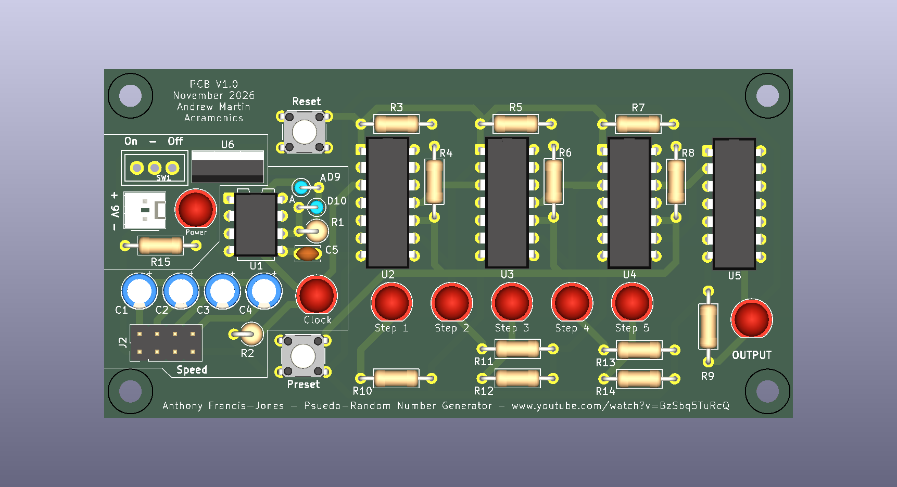

FJ-PseudoRandom
===============

acramonics November 2026
------------------------

KiCad version of pseudo-random number generator from Anthony
Francis-Jones (@AnthonyFrancisJones on YouTube).

This is a 6-Stage Linear Feedback Shift Register [LFSR] pseudo-random
number generator.

Anthony asked on his [YouTube
video](https://www.youtube.com/watch?v=BzSbq5TuRcQ) whether anyone
would be prepared to create a PCB, so here it is.

- [Schematic](./FJ-Random_Schematic.pdf)
- [Bill of Materials](./FJ-Random_BOM.csv)

